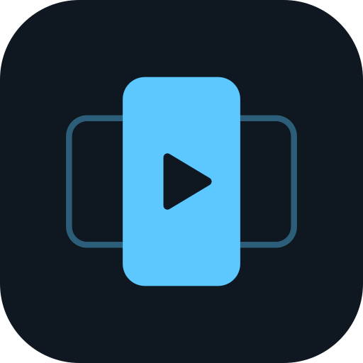
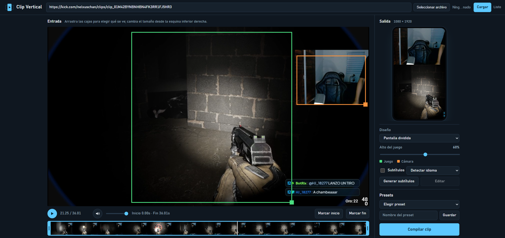

<p align="center">
  
</p>

<h1 align="center">Clip Vertical</h1>

<p align="center">
  Convierte clips horizontales de stream en videos verticales 9:16 para TikTok, YouTube Shorts e Instagram Reels.<br>
  Herramienta local y de uso personal, inspirada en Streamlabs Crossclip.
</p>

<!-- Agrega aquí una captura de pantalla:  -->

## Qué hace

- **Entrada:** pega el enlace de un clip o VOD (Twitch, YouTube, Kick y cualquier sitio que soporte [yt-dlp](https://github.com/yt-dlp/yt-dlp)) o sube un archivo de video.
- **Dos diseños:**
  - **Pantalla dividida:** cámara arriba y juego abajo. Arrastras dos cajas sobre el video para elegir qué parte se ve de cada uno, con la proporción bloqueada para que no se deforme.
  - **Centrado:** el video completo sobre un fondo difuminado de sí mismo.
- **Vista previa en vivo** del resultado vertical mientras mueves las cajas.
- **Línea de tiempo con miniaturas** para recortar el clip arrastrando el inicio y el fin.
- **Subtítulos automáticos** (opcional) con [faster-whisper](https://github.com/SYSTRAN/faster-whisper): se generan, se pueden **editar antes de exportar** y se ven en la vista previa. Salen en bloques cortos con la palabra activa resaltada.
- **Presets** de la posición de las cajas, guardados en tu navegador.
- **Barra de progreso** al exportar, con opción de cancelar.

Todo se procesa en tu equipo. Lo único que sale a internet es la descarga del enlace que pegues y, la primera vez que uses subtítulos, la descarga del modelo de Whisper.

## Requisitos

- Python 3.9 o superior
- [FFmpeg](https://ffmpeg.org/download.html) (incluye `ffprobe`) disponible en el `PATH`
  - Windows: `winget install ffmpeg`
  - macOS: `brew install ffmpeg`
  - Linux (Debian/Ubuntu): `sudo apt install ffmpeg`
- Un navegador moderno (probado el diseño pensando en Chrome)

## Instalación

```bash
git clone https://github.com/Nelxustt/Clip-Vertical.git
cd Clip-Vertical

python -m venv .venv
# Windows:      .venv\Scripts\activate
# macOS/Linux:  source .venv/bin/activate

pip install -r requirements.txt
```

Para los subtítulos automáticos, instala además:

```bash
pip install -r requirements-subs.txt
```

La primera vez que generes subtítulos se descarga el modelo `small` de Whisper (unos 500 MB). Sin tarjeta gráfica NVIDIA, transcribir tarda aproximadamente lo que dura el clip.

## Uso

```bash
python clip_vertical.py
```

Se abre `http://127.0.0.1:5000` en tu navegador.

1. Pega un enlace o sube un archivo y pulsa **Cargar**.
2. Elige el diseño. En **Pantalla dividida**, arrastra la caja naranja sobre tu cámara y la verde sobre el juego (la esquina inferior derecha de cada caja cambia el tamaño).
3. Recorta con la línea de tiempo.
4. *(Opcional)* Pulsa **Generar subtítulos**, corrígelos en el editor y deja marcada la casilla **Subtítulos**.
5. Pulsa **Compilar clip**. Los videos terminados se guardan en la carpeta `salidas/`.

## Cómo funciona

| Parte | Tecnología |
| --- | --- |
| Servidor | Flask (un solo archivo, `clip_vertical.py`) |
| Descarga | yt-dlp |
| Video | FFmpeg (recorte, escalado, `vstack`, subtítulos con `ass`) |
| Subtítulos | faster-whisper, con archivo ASS generado por palabra |
| Interfaz | HTML, CSS y JavaScript sin dependencias, dentro del mismo archivo |

La compilación corre en un hilo aparte y la interfaz consulta su progreso, por eso se puede seguir y cancelar.

## Archivos que genera

- `trabajo/`: descargas temporales. Se borra la del clip anterior al cargar uno nuevo y las de más de 24 horas al iniciar.
- `salidas/`: tus videos terminados. No se borran solos.

Ambas carpetas están en el `.gitignore`.

## Seguridad

El servidor solo escucha en `127.0.0.1`. No lo expongas a internet: no tiene autenticación y acepta cualquier enlace para descargar.

## Aviso

Es un proyecto personal y no está afiliado a Streamlabs ni a ninguna otra plataforma. Úsalo con contenido tuyo o con permiso de sus autores, y respeta los términos de servicio de cada plataforma y los derechos de autor.

## Ideas pendientes

- Detección automática de los mejores momentos de un VOD largo
- Cola para convertir varios enlaces seguidos
- Títulos y hashtags generados a partir de la transcripción
- Opciones de estilo para los subtítulos

## Licencia

[PolyForm Noncommercial 1.0.0](LICENSE). Puedes usar, modificar y compartir el código para fines **no comerciales** (uso personal, estudio, hobby, investigación u organizaciones sin fines de lucro). El uso comercial, incluida la venta o su inclusión en un producto o servicio de pago, requiere permiso del autor.

Es un proyecto de código disponible, no de código abierto en el sentido de la OSI.
